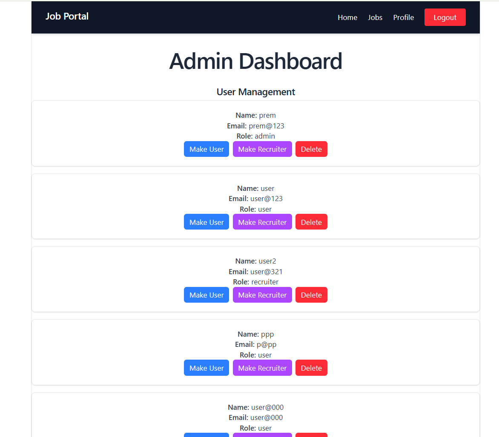
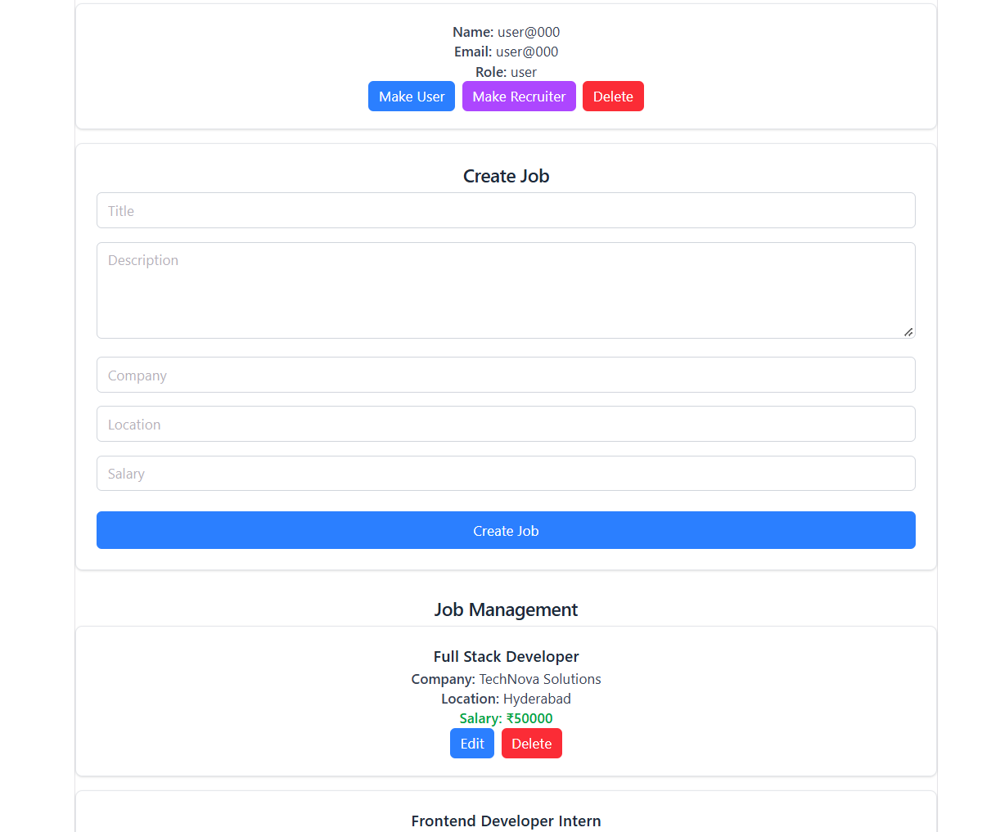

# MERN Job Portal

A full-stack job portal application built using the MERN stack. It allows users to browse jobs, apply for opportunities, and manage applications, while authorized users can post and manage job listings.

## 🌐 Live Demo

- Frontend:https://frontend-orcin-three-47.vercel.app
- Backend: https://job-portal-ex9x.onrender.com
- GitHub Repository: https://github.com/pkumarreddy104-coder/job-portal

## Features

- User registration and login
- JWT-based authentication
- Role-based authorization
- Job creation and job listing
- View job details
- Apply for jobs with a PDF resume
- View and manage job applications
- Resume uploads using Cloudinary
- Protected application routes
- MongoDB database integration
- Responsive user interface

##  Screenshots

### Admin Dashboard — User Management
Manage users and assign roles.



### Admin Dashboard — Job Management
Create, edit, and delete job listings.



### Job Management
View and manage available job listings.


### Job Details and Apply
View job information and apply with a PDF resume.


### My Applications
View submitted applications, their status, and the resume link.


##  Tech Stack

### Frontend
- React
- Vite
- React Router
- CSS

### Backend
- Node.js
- Express.js
- MongoDB
- Mongoose
- JWT authentication
- bcrypt
- Multer
- Cloudinary

- Deployment and Tools
- Vercel
- Render
- MongoDB Atlas
- Git and GitHub

##  Project Structure

```text
job-portal/
├── backend/
│   ├── models/
│   ├── routes/
│   ├── index.js
│   └── ...
├── frontend/
│   ├── src/
│   ├── public/
│   └── ...
├── package.json
├── package-lock.json
└── README.md
```

##  Run Locally

### Prerequisites

- Node.js and npm
- MongoDB Atlas account or a local MongoDB instance
- Cloudinary account for resume uploads

### 1. Clone the repository

```bash
git clone https://github.com/pkumarreddy104-coder/job-portal.git
cd job-portal
```

### 2. Install backend dependencies

From the project root:


```bash
npm install
```


### 3. Configure environment variables

Create `backend/.env` and configure the required variables:


```env
MONGO_URI=your_mongodb_connection_string
JWT_SECRET=your_jwt_secret
CLOUDINARY_CLOUD_NAME=your_cloudinary_cloud_name
CLOUDINARY_API_KEY=your_cloudinary_api_key
CLOUDINARY_API_SECRET=your_cloudinary_api_secret
```


### 4. Start the backend

From the project root:


```bash
node backend/index.js
```


### 5. Start the frontend

Open a second terminal:


```bash
cd frontend
npm install
npm run dev
```


Open the local URL displayed by Vite in your terminal.

## ☁️ Deployment

- Frontend deployed on Vercel
- Backend deployed on Render
- Database hosted on MongoDB Atlas
- Resume files stored using Cloudinary

##  Security

- Authentication using JWT
- Password hashing with bcrypt
- Protected routes and authorization checks
- Environment variables for sensitive configuration

##  What I Learned

- Building a full-stack MERN application
- Designing REST APIs using Express.js
- Implementing authentication and role-based authorization
- Connecting React frontend components to backend APIs
- Working with MongoDB and Mongoose
- Uploading and accessing resume files using Cloudinary
- Deploying a full-stack application

##  Author

 K.Prem Kumar Reddy

- GitHub: https://github.com/pkumarreddy104-coder
